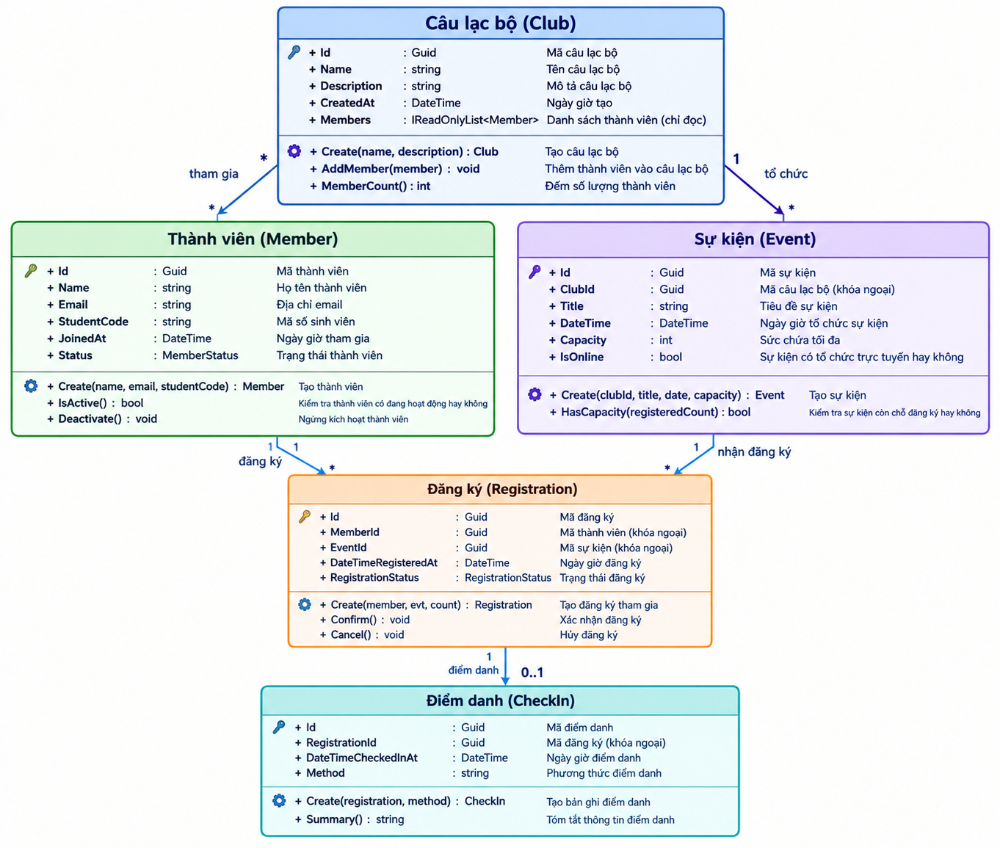
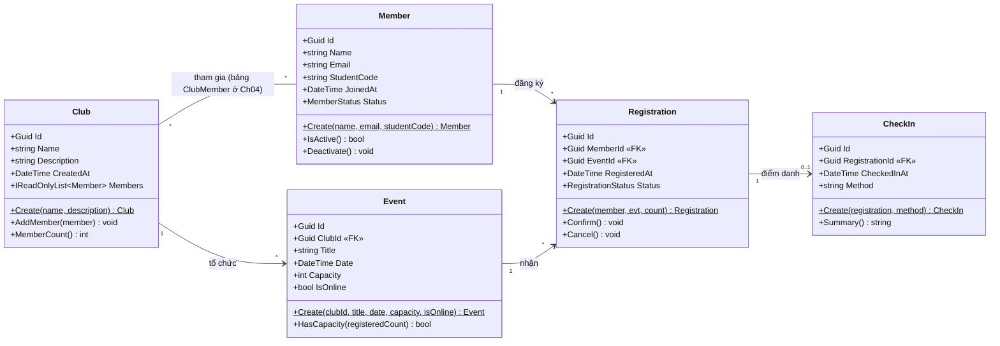
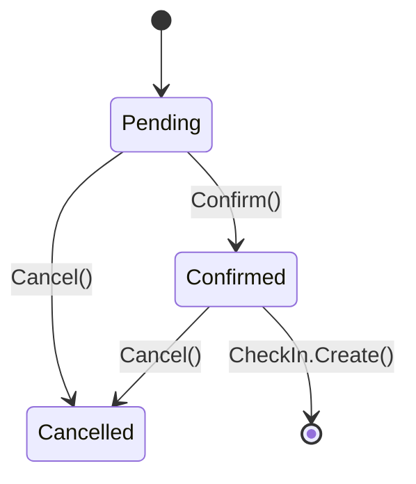

# Sơ đồ lớp EduHub

## 1. Sơ đồ lớp thiết kế (draw.io)

## 2. Sơ đồ lớp (Mermaid)

## Quan hệ và khoá ngoại

| Quan hệ | Loại | Khoá ngoại |
|---|---|---|
| Member — Club | * — * | bảng trung gian `ClubMember` (Ch04) |
| Club — Event | 1 — * | `Event.ClubId` |
| Member — Registration | 1 — * | `Registration.MemberId` |
| Event — Registration | 1 — * | `Registration.EventId` |
| Registration — CheckIn | 1 — 0..1 | `CheckIn.RegistrationId` |

Quy tắc: phía "nhiều" giữ khoá ngoại. Khoá chính của mọi entity là `Id` kiểu `Guid`.

## Vòng đời Registration

